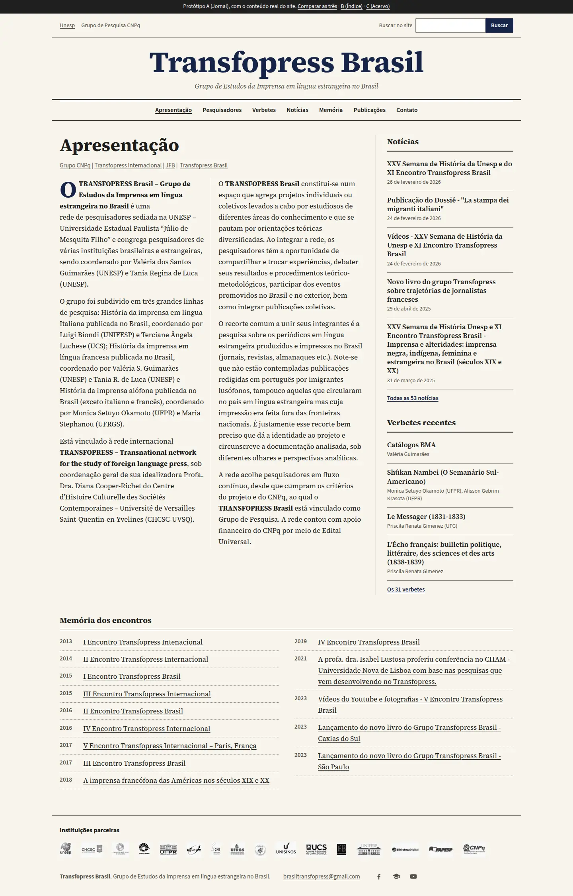
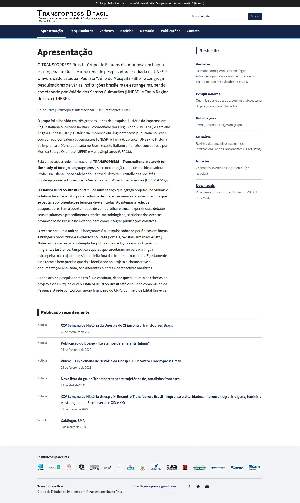
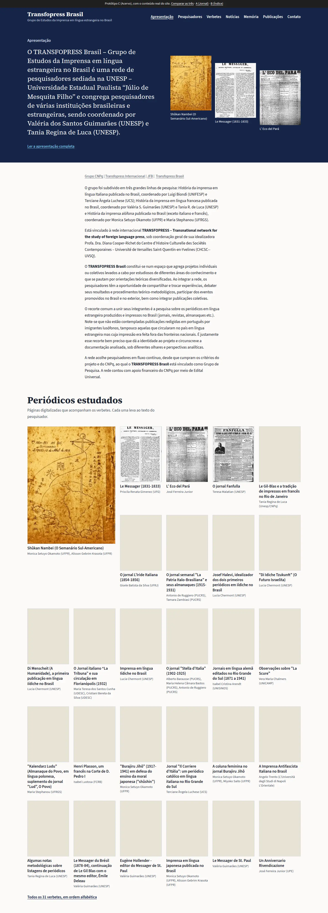

# Três alternativas de front-end

Protótipos para repensar a interface do site, feitos com as regras do
[antislop](https://github.com/miqdadbadjuber/anti-slop). O antislop é um filtro:
ele tira o que é genérico, mas não escolhe a direção. Por isso cada alternativa
abaixo declara a sua direção (o "Design Read" e os três controles do antislop:
ENERGY, RHYTHM e MOTION, de 1 a 3) e o motivo de cada escolha visual.

As três abrem a página inicial direto na **Apresentação**, usam só o conteúdo
real do banco e mantêm o azul-marinho `#152548` do tema original como cor da
marca. Os números que aparecem (53 notícias, 31 verbetes etc.) são contados no
banco a cada visita.

## Como ver

Com o site rodando (`npm run dev` ou num deploy desta branch):

- `/prototipos`: página de comparação, com links para as três;
- `/prototipos/a`, `/prototipos/b`, `/prototipos/c`: página inicial;
- `/prototipos/<a|b|c>/verbetes/<slug>`: um verbete no estilo de cada uma.

Os demais itens do menu levam às páginas atuais do site. As páginas dos
protótipos têm `noindex` e ficam fora do sitemap.

Capturas (computador e celular) em [`docs/prototipos/`](prototipos/).

## A. Jornal

- **Design Read:** site de grupo de pesquisa em história da imprensa, para
  pesquisadores e estudantes, na linguagem de uma página de jornal impresso.
  ENERGY 2 / RHYTHM 2 / MOTION 1.
- **Cabeçalho:** o nome do grupo composto como o título de um jornal, em
  Source Serif 4. Abaixo, o fio duplo (grosso e fino) que separa o cabeçalho do
  corpo nos jornais que o grupo estuda. Esse fio é o motivo de identidade e se
  repete nos títulos de seção.
- **Página inicial:** a Apresentação é a matéria principal, em duas colunas com
  capitular. Ao lado, a coluna de "Notícias" e "Verbetes recentes" em forma de
  manchetes, só título e data, sem cartões. Embaixo, a memória dos encontros em
  ordem cronológica.
- **Cores:** papel `#f7f4ec`, tinta `#1c1c1a` e o marinho só no nome do jornal,
  na capitular e nos links "Todas as notícias". Esse é o acento único.
- **Para quem:** passa a ideia de imprensa logo na entrada. É a mais distante do
  site atual e a que mais pede texto bem cuidado no admin.

## B. Índice

- **Design Read:** site institucional, para quem chega procurando um verbete,
  um pesquisador ou um contato, em linguagem de serviço público: clara e
  previsível. ENERGY 1 / RHYTHM 1 / MOTION 1.
- **Cabeçalho:** o logo atual, a busca com rótulo visível e o menu numa faixa
  marinho. A régua azul-clara `#73bfe5` do tema original fica sob o cabeçalho e
  é o acento.
- **Página inicial:** a Apresentação com o primeiro parágrafo em destaque e o
  resto em coluna de leitura (até 40rem). Ao lado, "Neste site": um índice das
  seções com uma frase sobre cada uma e a contagem real de itens. Embaixo,
  "Publicado recentemente", com notícias e verbetes juntos por data.
- **Tipografia:** uma família só (Source Sans 3, a do site atual), em corpo
  maior (18 px) para leitura longa.
- **Para quem:** a mudança mais segura. É a mais próxima do site atual, com
  outra hierarquia, e a mais fácil de manter.

## C. Acervo

- **Design Read:** vitrine de um grupo que estuda jornais e revistas, para
  público acadêmico e curioso, em linguagem editorial de arquivo, com as páginas
  digitalizadas como protagonistas. ENERGY 3 / RHYTHM 3 / MOTION 1.
- **Abertura:** fundo marinho, o primeiro parágrafo da Apresentação em serifa
  grande e três páginas de periódicos dos verbetes. A Apresentação completa vem
  logo abaixo.
- **"Periódicos estudados":** o mural com as 27 páginas digitalizadas que
  acompanham os verbetes, cada uma levando ao texto do pesquisador. A primeira
  ocupa o dobro do espaço. O motivo de identidade é o retrato 3:4, como ficha de
  acervo.
- **"Encontros e lançamentos":** a linha do tempo dos 14 registros de memória,
  de 2013 a 2023, sobre o marinho, com os anos no azul-claro do tema (7,9:1).
- **Para quem:** a mais forte visualmente, mas depende de os verbetes novos
  terem imagem. Hoje 27 de 31 têm.

## O que vale para as três

- O rodapé troca a imagem única de logos (sem texto alternativo no site antigo)
  por 16 logos com nome e link, vindos da coleção "Parceiros" do admin.
- Menu, busca e links funcionam pelo teclado, com foco visível. No celular, o
  menu da C abre num botão "Menu" (`
`).
- Trechos em outro idioma levam o atributo `lang` (títulos e resumos), como no
  site atual.
- Fontes servidas pelo próprio site (Source Serif 4 e Source Sans 3, licença
  OFL), sem Google Fonts.

## Checagem do antislop

Conferido com o site rodando localmente, com o banco preenchido pelo
`seed/seed.json`.

| Regra | Resultado |
|---|---|
| R-02, sem travessão | PASS: nenhum `—` ou `–` nos arquivos novos. |
| R-03, nada vaza no celular | PASS: `scrollWidth` 390 em 390 px nas três páginas iniciais e nos verbetes (Fanfulla, Catálogos BMA, Le Gil-Blas). Antes havia links longos estourando a coluna dos verbetes; agora quebram. |
| R-17, R-18, R-36, R-38, nada inventado | PASS: todo texto, data, imagem e contagem vem do banco. Não há números, depoimentos nem logos que o site não tenha. |
| R-24, R-26, links e controles reais | PASS: cada item do menu leva a uma página que existe. A busca envia para `/busca`. |
| R-25, contraste | PASS: Lighthouse, acessibilidade 100 nas três páginas iniciais. Texto principal entre 15:1 e 16:1. |
| R-39, acessibilidade básica | PASS: `lang="pt-BR"`, `<title>`, regiões (`header`, `nav`, `main`, `footer`), link para pular ao conteúdo, busca com rótulo, todas as imagens com `alt` (0 sem). |
| R-40, desempenho | PASS: imagens com largura e altura. A primeira imagem da C carrega antes (`eager`), as demais depois. Sem script de terceiros. |
| R-01, R-07, R-10, R-12, R-13, decoração | PASS: sem gradiente, brilho, vidro, grade de fundo ou sombra. |
| R-05, R-14, composição | PASS: nenhuma das três segue o roteiro herói, cartões, depoimentos, perguntas e chamada final. As seções saem do conteúdo (apresentação, manchetes, mural, linha do tempo). |
| R-06, tipografia | PASS: serifa na A e na C porque o assunto é a imprensa impressa; Source Sans na B por ser a do site atual. Sem caixa alta espaçada nem fonte monoespaçada. |
| R-29, paleta | PASS: no máximo três cores e um acento em cada alternativa. |
| Controles do antislop | PASS: cada alternativa declara Design Read e ENERGY/RHYTHM/MOTION (acima e no topo de cada `Layout*.astro`). |
| `astro check` | PASS: 0 erros, 0 avisos. |

O Lighthouse dá 66 em SEO nas três porque as páginas dos protótipos têm
`noindex` de propósito.

## Próximo passo

Escolhida uma alternativa (ou uma mistura), o estilo dela passa para
`src/layouts/Base.astro`, `src/pages/index.astro` e `public/static/css/site.css`,
e a pasta `/prototipos` sai do site.
